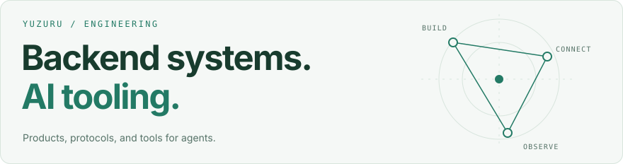

# Matvei Riabushkin

<picture>
  <source media="(prefers-color-scheme: dark)" srcset="./assets/header-dark.svg">
  
</picture>

Backend developer in Moscow, studying at **HSE University** and **Central University**.
I build web products and the tools I use to develop them: agent skills, plugins, MCP servers, and harnesses.

[Telegram](https://t.me/Keyko_Mi) · [Email](mailto:matveyryabushkin@gmail.com)

## AI in my workflow

**Codex · Claude Code · Gemini · DeepSeek Harness**

- **Agent workflows.** I use multi-agent systems, maintain my own harness, and write reusable skills and plugins.
- **Tool integration.** I build MCP servers to connect agents with real services; this includes work at ObjectTech.
- **Multimodal APIs.** I work with LLMs, vision-language models, speech-to-text, and text-to-speech.
- **Local inference.** I've run Llama models and generated video locally. I'm also studying how open models such as DeepSeek work under the hood.

## Selected projects

| Project | What I build |
| :--- | :--- |
| **[Yuzuru Engineering Extensions](https://github.com/MattoYuzuru/yuzuru-skills)** | Skills, plugins, MCP integrations, and helpers shared across Codex, Claude Code, and DeepSeek Harness. |
| **[Kansoku](https://github.com/MattoYuzuru/Kansoku)** | Local observability for coding agents: which skills and tools they actually use, with coverage and provenance for the data. |
| **[BPMN.Space](https://github.com/MattoYuzuru/BPMN.Space)** · [Try it](https://bpmn.space) | A two-person hackathon project turning documents and voice notes into editable BPMN diagrams, with source-backed clarification. |
| **[Mnema](https://github.com/MattoYuzuru/Mnema)** · [Try it](https://mnema.app) | Learning from your own material: exercises, spaced repetition, and AI-assisted authoring. Java / Spring Boot + Angular. |
| **[Jack](https://github.com/MattoYuzuru/Jack)** | A web toolkit for files, media, PDFs, and developer utilities. Java / Spring Boot + Vue. |

<strong>Watch BPMN.Space in action</strong>

Documents → clarifying questions → an editable process diagram.

Built with Timofey Yakovlev for the “AI Assistants for Energy” hackathon.

## Stack & tech radar

| Area | Technologies |
| :--- | :--- |
| **Backend** | Java, Python, Go · Spring Boot, FastAPI · PostgreSQL, Redis |
| **Web & mobile** | TypeScript · Angular, React, Vue · Kotlin Multiplatform |
| **Delivery** | Docker, Linux, GitHub Actions |

My current radar reflects what I use, build, and investigate:

| Use | Build | Explore |
| :--- | :--- | :--- |
| Codex, Claude Code, Gemini | Agent skills & plugins | Open model internals |
| Multi-agent workflows | MCP servers & harnesses | LLM / VLM inference |
| Speech & language APIs | Agent observability | Local video generation |

## GitHub activity

<picture>
  <source media="(prefers-color-scheme: dark)" srcset="./profile/stats-dark.svg">
  
</picture>
<picture>
  <source media="(prefers-color-scheme: dark)" srcset="./profile/languages-dark.svg">
  
</picture>

Updated daily from GitHub. Language shares describe repository code, not proficiency.

<strong>A year of contributions, animated</strong>

<picture>
  <source media="(prefers-color-scheme: dark)" srcset="./profile/snake-dark.svg">
  
</picture>

Powered by [snk](https://github.com/Platane/snk).

## Away from the editor

Travel, language learning, photography, and Japanese and Chinese tea.
I also built **[Polka](https://github.com/MattoYuzuru/Polka)**, a personal bookshelf for recommendations, quotes, and reading notes.
